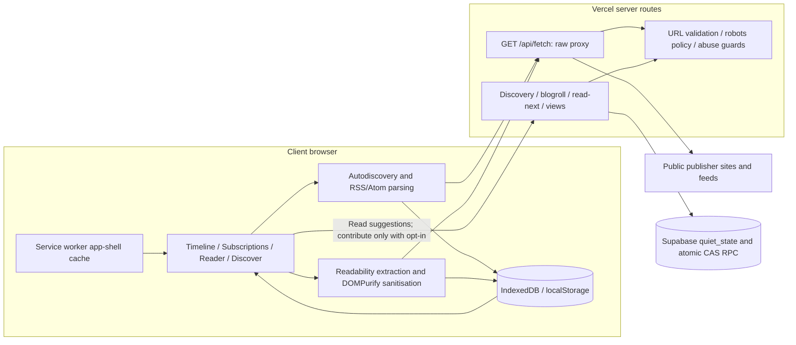

# Quiet Web

**PECathon · Team Byte Me**

A browser-first RSS/Atom reader with a unified timeline, full-text reading, local offline caches and optional anonymous discovery. Stack: HTML/CSS/JavaScript, GSAP, Node.js, Vercel and Supabase.

## 1. Architecture Overview



### Client and server responsibilities

- **Browser:** find alternate feed links/common feed paths, parse RSS/Atom, merge posts chronologically, extract articles with Mozilla Readability, sanitise HTML with DOMPurify, and persist downloaded text and reading state locally. Tags, highlights and saved stories remain local.
- **Fetch route:** validate destinations and redirects, check robots.txt, forward conditional headers and return raw content. It does not parse feeds, extract articles or store publisher pages. Parsing robots policy is separate from feed/article processing.
- **Discovery routes:** collect optional anonymous batches, aggregate support, rank feeds, exclude followed feeds and return explanatory reasons.
- **Supabase:** private `quiet_state(key, version, body)` table with RLS/server-role grants. `quiet_compare_swap` updates versioned JSON state atomically. The frontend never talks directly to this table.

### API routes

- `GET /api/fetch?url=<encoded-url>&raw=1`: raw publisher text plus final-URL/content-type metadata. Optional `etag`/`modified` parameters forward conditional headers; unchanged content returns 304.
- `GET /api/discovery/token`: signed single-use token, valid for five minutes.
- `POST /api/discovery/submit`: `{feeds, token}`, one complete anonymous batch of 1–30 public feed URLs.
- `POST /api/discovery/recommendations`: `{feeds}`, read suggestions without contributing.
- `GET /api/discovery/popular`: supported popular feeds or separate editorial seed fallback.
- `POST /api/discovery/blogroll`: `{from, links, token}`, up to 20 public A-links-to-B claims.
- `GET /api/read-next?from=<feed>` / `POST /api/read-next` with `{from, to, token}`: aggregate reading transitions; client contribution follows the sharing choice.
- `GET /api/views?feed=<feed>` / `POST /api/views` with `{feed}`: aggregate counters, separate from subscription-sharing opt-in. These do not measure unique readers.

### Source map

`app.js` and `index.html` implement the UI. `reader-extraction.js` handles extraction/sanitisation. `reader-storage.js`, `feed-sync.js` and `sw.js` manage caches and refresh. `feed-tools.js` adds OPML/tags/blogrolls. `reader-tools.js`, `speech-reader.js` and `screen-time.js` provide graphs/highlights, speech and break reminders. `server.js` runs locally and supplies shared fetch validation. `api/router.js` serves Vercel APIs. `lib/` contains database/security/robots/seed helpers. `scripts/build-vercel.cjs` creates allowlisted `public/` assets.

## 2. Setup Instructions

### Local setup

Use Node.js 24 LTS and npm. Open PowerShell inside the extracted project folder containing `package.json`:

```powershell
npm.cmd ci
npm.cmd start
```

Open **http://127.0.0.1:4174/**. Using `npm.cmd` avoids PowerShell's `npm.ps1` execution-policy error. Stop with Ctrl+C. If the port is busy, stop the existing server or set `$env:PORT = '4175'` before starting again.

The reader/proxy can run without database configuration. Anonymous discovery/read-next needs Supabase. Local view counters use `data/views.json`; production counters use Supabase. Keep local `data/` out of Git.

### Environment variables

Copy `.env.example` to `.env`, replace the placeholder privately and use:

```dotenv
SUPABASE_URL=https://YOUR_PROJECT.supabase.co
SUPABASE_SECRET_KEY=YOUR_SERVER_ONLY_SECRET_KEY
```

- `SUPABASE_URL`: public project API URL. Existing project: `https://iaasjkjxdpncjklsikkm.supabase.co`.
- `SUPABASE_SECRET_KEY`: server-only `sb_secret_...` key, or supported legacy service-role key. A publishable/anon key lacks required server permissions.
- `PORT`: optional local port, default 4174.

`npm.cmd start` does not load `.env` automatically. To load it with Node 24:

```powershell
node --env-file=.env server.js
```

Never commit `.env` or expose the secret in frontend code, screenshots, chat or README. No browser Supabase key or user-auth setup is required. The server derives its signing salt from the server secret; key rotation invalidates pending tokens.

### Supabase setup

For a **new database**, run these files separately in SQL Editor, in order:

1. `supabase/migrations/001_quiet_web.sql`: private state table, RLS/grants and atomic update RPC.
2. `supabase/migrations/002_remove_legacy_identifiers.sql`: targeted deletion of old `discovery` and `read-next` contributor-linked records. It preserves view counts and current anonymous records. Inspect this deletion before running against an older installation.
3. `supabase/migrations/003_demo_discovery_dataset.sql`: separate synthetic discovery evidence for a nonempty demo. Existing seed state is not overwritten. Sample evidence does not represent real users.

For the **existing configured database**, reuse its URL/key and keep existing data. Changing GitHub repositories does not require a new database or rerunning completed migrations. The final feature update needs no additional SQL. Deployments pointing at the same Supabase project share server aggregates.

### Vercel and moving to a different GitHub repository

1. Upload source at the new repository root. Preserve `api/`, `lib/`, `scripts/`, `samples/` and `supabase/`. Do not upload `.env`, `.git`, `node_modules/`, generated `public/`, `data/`, source ZIPs or presentation outputs.
2. In Vercel choose **Add New → Project** and import the new repository. Root Directory is `./` when `package.json` is at the repository root.
3. Use preset **Other**. `vercel.json` defines build command `node scripts/build-vercel.cjs`, output `public`, API rewrites and function settings. Install dependencies with npm.
4. Enter `SUPABASE_URL` and `SUPABASE_SECRET_KEY` in this Vercel project's environment variables. Select Production and any Preview environments you need. A new Vercel project does not inherit another project's variables automatically.
5. Deploy and check the website, an article import and `/api/discovery/popular`. Redeploy after changing environment variables.
6. Later commits to the connected production branch normally trigger production deployments. Changes in an unrelated repository do not update the old Vercel project.

To keep the existing Vercel project/URL, change its connected repository in **Project Settings → Git**, preserve environment variables, check production branch/root directory and deploy from the new connection. Verify the replacement before removing any working deployment.

**New URL means separate browser storage.** Even with the same database, a different Vercel origin starts a separate local library/cache. Export OPML in Library on the old URL and import it on the new URL to transfer subscriptions/tags. OPML does not transfer articles, highlights or read state. Those remain under the old browser origin unless separately migrated.

Build locally with `node scripts/build-vercel.cjs`.

Official setup references: [Vercel Git deployment](https://vercel.com/docs/git), [project settings](https://vercel.com/docs/project-configuration/project-settings), [environment variables](https://vercel.com/docs/environment-variables), [Supabase API keys](https://supabase.com/docs/guides/getting-started/api-keys).

## 3. Privacy & Threat Model

### What stays local

Subscriptions, cached feed entries, extracted article HTML, read/unread state, saves, highlights, tags, detected blogrolls before submission and user preferences stay in browser storage. They are device/origin-specific. Clearing or evicting browser storage removes them.

### What the server stores and never stores

The server stores normalized public feed URLs with aggregate popularity/pairing support, submitted blogroll edges, aggregate read-next evidence, view counters, hashed token replay records and a separate synthetic demo dataset. Vote hashes are scoped to a feed pair and single-use request nonce, not a reusable reader ID. Aggregate evidence persists until administratively removed.

The application does **not persist fetched feed/article bodies, extracted article text, private annotations/read-state libraries, accounts, email addresses, reusable browser IDs or raw IPs in application state**. The proxy necessarily receives URLs/content transiently. Opted-in lists arrive as one transient batch before aggregation. Vercel, Supabase and publishers may retain infrastructure request logs/network metadata separately; configure those policies independently. This is not cryptographic anonymity.

### Opt-in

Anonymous subscription contribution defaults **off**. Enabling it allows the client to send its whole public feed list with a fresh single-use token. Reading recommendations alone does not contribute. Turning sharing off prevents future optional submissions but cannot identify/retract earlier anonymous aggregate evidence.

Blogroll contribution has a separate checkbox in **Library → Subscriptions & organisation** and requires pressing Submit. Detection stays local until submission. Read-next contribution follows the sharing preference. View updates are a separate counter feature and are not controlled by the subscription-sharing toggle. The app creates no accounts, persistent reader IDs or authentication cookies.

### Implemented protections

- Validate HTTP(S) destinations, reject credentials/private/local/reserved addresses, constrain discovery ports and validate redirect destinations. Bound JSON requests to 20 KB and batches to 30 feeds.
- Normalize scheme, www, fragments, tracking parameters, trailing slashes, query order and common feed-path aliases in discovery. Deduplicate within a batch.
- Use signed random-nonce tokens with five-minute expiry and atomic single-use consumption. Prune expired replay records during later token consumption.
- Rate-limit production API requests to 100/minute/instance using only minute-scoped server-salted IP HMAC keys with 60-second logical expiry in memory.
- Require three accepted batches and weighted support of at least two for aggregate ranking eligibility. Accepted batches are not proven distinct humans.
- Downweight large, repetitive or hostname-concentrated lists. Combine 70% log co-subscription and 30% log popularity. Return at most two results per hostname and exclude followed feeds.
- Bound blogroll submission to 20 links/request and 100 unique outgoing links/source. A matching source adds only a 0.15 boost to already eligible results. Repeating the same edge does not multiply support.
- Reject cross-origin mutation requests when the Origin header identifies a different host. Keep server credentials out of browser code and restrict direct database access.
- Sanitise extracted, feed-provided and cached HTML before rendering. Bound proxy responses/timeouts. Respect robots rules, refuse fetches when policy retrieval is unreachable/5xx, and permit unavailable 4xx policy files.

### Accepted risks

Determined Sybil attackers can obtain fresh tokens and submit fabricated lists from different networks. No-ID operation cannot reliably deduplicate returning humans. In-memory limits are approximate across serverless instances; distributed limits remain future hardening. Blogroll edges are client claims, not verified publisher ownership/links, so their ranking influence stays small.

DNS validation followed by ordinary fetch leaves a DNS-rebinding time-of-check/time-of-use risk; pinned-address transport or controlled egress is recommended for sensitive production use. Unusual publisher aliases may remain distinct. Publisher access restrictions/paywalls still apply. View counters are not bot-resistant audience analytics. Demo display numbers and synthetic/editorial picks must not be represented as measured traffic or real reader endorsements.

## 4. Demo Instructions

### Sample sites

Paste one of these into **Add a blog**:

- Squiggle Line Cafe: `https://thesquigglelinecafe.wordpress.com/feed/`
- WordPress News: `https://wordpress.org/news/feed/`
- Matt Mullenweg: `https://ma.tt/feed/`
- WordPress.com Blog: `https://wordpress.com/blog/feed/`
- Pluralistic: `https://pluralistic.net/feed/`

The full list contains 12 real blogs in `samples/seed-blogs.json`. Suggestions never auto-subscribe or share a visitor's list. Reports are point-in-time evidence; publishers can change formats/access policies. Prefer public publisher URLs over account-profile or platform Reader wrapper links.

### Walkthrough

1. Add two blogs. Show chronological posts, feed filtering and read/unread controls.
2. Open full text, highlight in green/orange, save a story and optionally play browser text-to-speech. Show favourites in Library and the optional hourly break reminder.
3. Download/save full text online and wait for successful caching/service-worker activation. In browser DevTools → Network choose **Offline**, reload and reopen the cached article. Restore **Online** afterward. Uncached text cannot download offline.
4. Add feed tags, export OPML, then reimport with preview/duplicate checks. Nested folder labels become tags. Export includes subscriptions/tags, not article/highlight backups.
5. Show Discover with sharing off. Explain supported aggregate reasons versus editorial seeds. If desired, enable contribution and show that followed feeds stay excluded.
6. Mark an article finished to open the related-blogs graph. On a site with explicit blogroll markup, show detected links and the separate optional Submit control.
7. Reconnect and refresh. Cached full text, read/saved state and highlights should survive. Periodic refresh runs every 15 minutes while the app is open, online and visible, with failure backoff.

### Edge cases

- **No feed:** `https://example.com/` is a useful candidate. Expect a clear discovery error with the existing timeline unchanged. External sites can change; use controlled fixtures for deterministic evaluation.
- **Dead feed / slow server:** an unavailable endpoint or timeout reports an error without deleting cached stories. `test-feed-handling.cjs` exercises failed-fetch/timeout fixtures without depending on live outages.
- **Malformed XML:** the same test checks malformed RSS and valid RSS/Atom/autodiscovery cases. One bad feed must not break others.
- **Extraction failure:** blocked fetching, empty article markup or a paywall should leave the feed summary available with an explanation. `test-reader-extraction.cjs` checks empty-page fallback and sanitisation deterministically. Medium can fail, but is not a stable test fixture.
- **Duplicate URLs:** add the same feed again and try its fragment/tracking variant. Check that subscriptions and normalized evidence do not duplicate. Common aliases normalize; arbitrary custom aliases may remain distinct. Ranking/security/OPML tests cover duplicate handling.
- **Unsafe URL:** use `javascript:` or `http://127.0.0.1/` as a publisher input and expect rejection. Do not use real internal services as test feeds.
- **Conditional fetch / robots:** `test-final-features.cjs` checks forwarded validators, 304 cache preservation, robots allow/disallow rules and unavailable policy responses.
- **Replay / low support:** security/ranking tests reject token reuse and unsupported aggregate rankings. Editorial fallback may still populate Discover without claiming real engagement.

### Verification

Run from the project root after dependency installation:

```powershell
npm.cmd run check
node scripts/test-app-boot.cjs
node scripts/test-feed-handling.cjs
node scripts/test-wordpress-reader.cjs
node scripts/test-reader-extraction.cjs
node scripts/test-offline-first.cjs
node scripts/test-feed-refresh.cjs
node scripts/test-ranking.cjs
node scripts/test-discovery-security.cjs
node scripts/test-final-features.cjs
node scripts/build-vercel.cjs
node scripts/test-demo-dataset.cjs
```

Optional network checks: `node scripts/verify-seed-blogs.cjs` and `node scripts/verify-live-reader.cjs`. They contact public publishers; live-reader checks also read demo API endpoints and write point-in-time reports to `outputs/`.

DOM/storage tests do not prove actual voice playback, deployed service-worker offline reload or compatibility with hidden judge sites. Test those manually before presenting. Previously downloaded text persists while storage remains available; offline images/fonts are not guaranteed.

Implementation references: [Readability](https://github.com/mozilla/readability), [DOMPurify](https://github.com/cure53/DOMPurify), [OPML 2.0](https://2005.opml.org/spec2.html), [HTTP semantics](https://www.rfc-editor.org/rfc/rfc9110), [robots.txt](https://www.rfc-editor.org/rfc/rfc9309).
